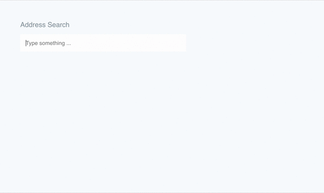

# Open-Meteo Autocomplete implementation for Vue.js

A Vue components to provide address search functionality with improved user experience and advanced customisation options.



This component is based on vue-better-google-places-autocomplete and can be used alike.
vue-better-google-places-autocomplete example implementations can be found in their [demo repository](https://github.com/dewsign/examples-vue-better-google-places-autocomplete)

## Key Improvements

* Allow enter key to select the first search result
* Keyboard navigation
* Customisability
* Simplified events handling

## Installation

```sh
npm i vue-open-meteo-autocomplete
```

You can either import the package as a plugin or the components.

### Plugin usage

```js
import OpenMeteoAutocompletePlugin from 'vue-open-meteo-autocomplete'

Vue.use(OpenMeteoAutocompletePlugin)
```

### Component usage

```js
import { OpenMeteoAutocomplete } from 'vue-open-meteo-autocomplete'

Vue.component('open-meteo-autocomplete', OpenMeteoAutocomplete)
```

## Usage

The component itself comes with very basic defaults and assumes that you will either style the default output or use the named scoped slots to customise each element.

Basic usage will output an input text box and an unordered list for returned entries.

```html
<template>
  <div>
    <open-meteo-autocomplete />
  </div>
</template>
```

## Dealing with results

The component emits events which you can use to respond to address search selection.

```html
<open-meteo-autocomplete
    @resultChanged="placeDetail => place = placeDetail"
    @resultCleared="() => place = null"
/>
```

### `resultChanged`

This event is fired when a user has selected an address from a search. This will include the the api resonse from open meteo (https://open-meteo.com) as the event payload.

### `resultCleared`

This event is fired when the user has removed all text from the search box or clicked the clear icon. Useful for re-centering the results map for example.

## Pre-populating search and results

Sometimes you may with to pre define the search query and/or result as defaults for the component. E.g. if you have multiple search components on different screen and need to maintain the same results for both.

```html
<open-meteo-autocomplete
    @resultChanged="placeDetail => place = placeDetail"
    @resultCleared="() => place = null"
    value="London, UK"
    :place="defaultPlace"
/>
```

## Customisation

Two scoped-slots are provided to customise the search input box and the results

### Search Input

```html
<open-meteo-autocomplete>
    <div slot="input" slot-scope="{ context, events, actions }">
        <label for="locationInput">Address Search</label>
        <input
            v-model="context.input"
            @focus="events.inputHasReceivedFocus"
            @input="events.inputHasChanged"
            @keydown.enter.prevent="actions.selectItemFromList"
            @keydown.down.prevent="actions.shiftResultsSelection"
            @keydown.up.prevent="actions.unshiftResultsSelection"
            type="search"
            id="locationInput"
            placeholder="Type something ..."
        >
    </div>
</open-meteo-autocomplete>
```

### Search Results

The underlying `ul` and `li` are not accessible via slots but you can style them using the provided css class on the `ul`, `.vbga-results`. Additionally, the currently selected list item will receive a `highlighted` class.

```html
<open-meteo-autocomplete>
    <span slot="item" slot-scope="{ place }">
        {{ place.description }}
    </span>
    <span slot="activeItem" slot-scope="{ place }">
        {{ place.description }}
    </span>
</open-meteo-autocomplete>
```
